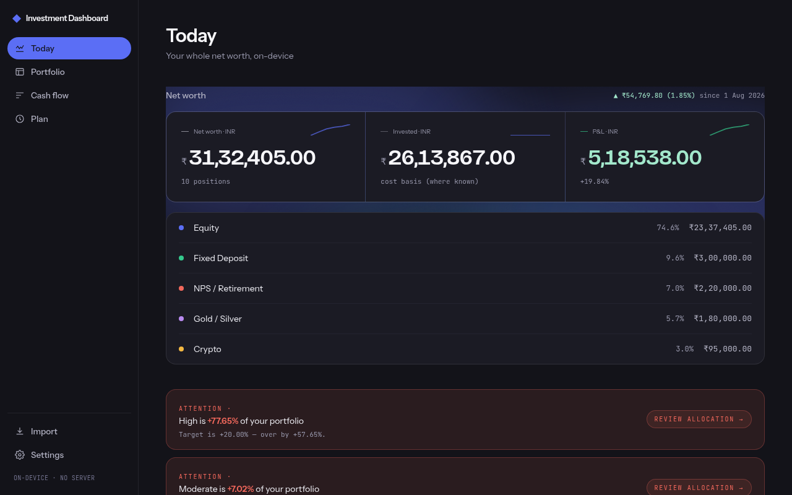
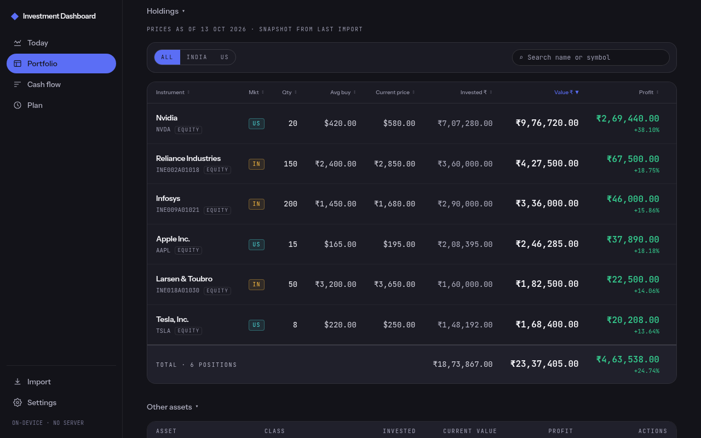
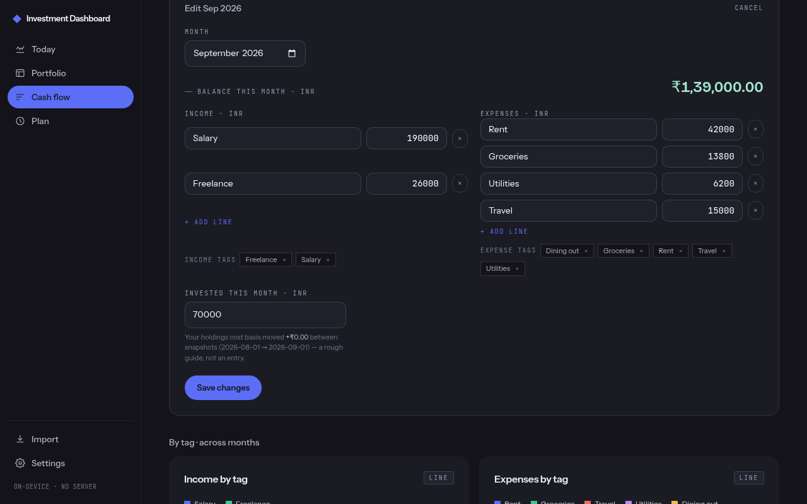
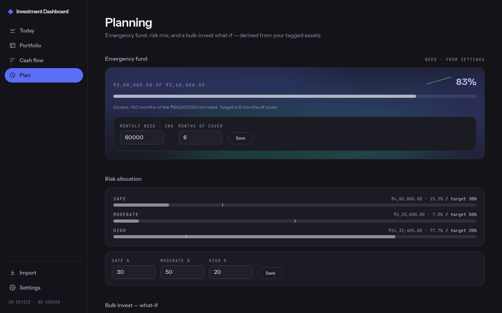
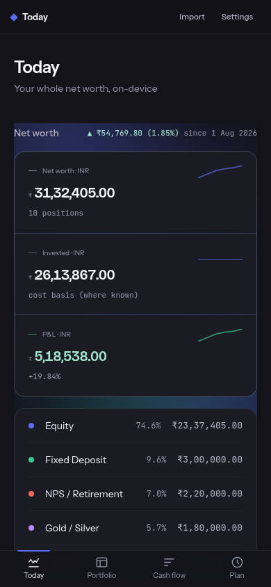
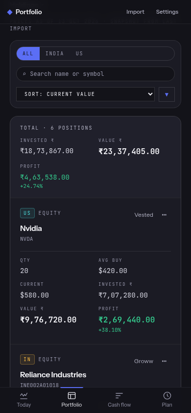

<div align="center">

  # Investment Dashboard

  <strong>An edge-only dashboard for tracking personal investments across the Indian and US stock markets.</strong>
  <br />
  No accounts. No backend. No telemetry. Your portfolio, your browser.

  <br />

  [](https://gupta-ujjwal.github.io/investment-dashboard/)

  <br />
  <br />

  [](https://github.com/gupta-ujjwal/investment-dashboard/actions/workflows/deploy.yml)
  [](./LICENSE)
  [](https://react.dev/)
  [](https://www.typescriptlang.org/)
  [](https://tailwindcss.com/)
  [](./CONTRIBUTING.md)

  <p>
    <a href="#-features">Features</a> •
    <a href="#-screenshots">Screenshots</a> •
    <a href="#-getting-started">Getting Started</a> •
    <a href="#-tech-stack">Tech Stack</a> •
    <a href="#-architecture-notes">Architecture</a> •
    <a href="#-contributing">Contributing</a>
  </p>
</div>

<br />

## What is Investment Dashboard?

**Investment Dashboard** is for people who hold stocks in both India and the
US and want one honest view of the whole portfolio — without handing a
broker login or a ticker list to a third-party service. Import a broker
export, see allocation/P&L/net-worth analytics computed entirely on your
device, and track cash flow and goals alongside it.

Everything lives in your browser's IndexedDB — there's no backend, no
tracking, and no sign-up. Clone it, run it, and it's yours.

> **Status:** Phase 1 equities are live, plus a personal-finance layer beyond
> the original equity-only scope — import (Vested + Groww XLSX), a unified
> Portfolio view, base-currency FX conversion, Overview net-worth/analytics,
> Budget (cash flow), and Planning (goals + risk mix) all ship on by default.
> Manual price snapshots are still the only price-data path; live price
> feeds remain out of scope (see [Roadmap](#-roadmap--known-limitations)).

## ✨ Features

|                              |                                                                                                    |
| ---------------------------- | -------------------------------------------------------------------------------------------------- |
| 🌍 **Two markets, one view**  | India (NSE/BSE, INR) and US (NYSE/NASDAQ, USD) holdings in a single, base-currency-converted portfolio |
| 📥 **Broker import**          | Upload a Vested or Groww XLSX export; re-import merges by instrument with sticky per-field overrides |
| 📊 **Overview & analytics**   | Net worth, allocation, sector/currency exposure, benchmark overlay (NIFTY 50 / S&P 500), concentration risk |
| 💰 **Budget (cash flow)**     | Monthly income/expense tracking with reusable tags and a live running balance |
| 🎯 **Planning**               | Goals and a risk-band mix across your whole portfolio, including manually-added assets |
| 💱 **FX, your way**           | Live reference-rate fetch from a public, no-key ECB feed, or paste your own rate offline |
| 💾 **Backup / restore**       | Full export/restore of every store, with a preview step before any destructive restore |
| 🔒 **Local-first**            | No accounts, no server — every byte of portfolio data stays in your browser's IndexedDB |

## 📸 Screenshots

The app is fully responsive — the same dashboard, not a cut-down mobile view.

**Desktop**

<table>
  <tr>
    <td align="center" width="50%"><b>Today — net worth, allocation, history</b><br/></td>
    <td align="center" width="50%"><b>Portfolio — holdings, colour-keyed by market</b><br/></td>
  </tr>
  <tr>
    <td align="center" width="50%"><b>Budget — side-by-side income/expense editor</b><br/></td>
    <td align="center" width="50%"><b>Planning — emergency fund & risk allocation</b><br/></td>
  </tr>
</table>

**Mobile**

<table>
  <tr>
    <td align="center" width="50%"><b>Today</b><br/></td>
    <td align="center" width="50%"><b>Portfolio</b><br/></td>
  </tr>
</table>

## 🚀 Getting started

Requires Node.js 20+.

```bash
git clone https://github.com/gupta-ujjwal/investment-dashboard.git
cd investment-dashboard
npm install
npm run dev
```

The app will be available at `http://localhost:5173/investment-dashboard/`.

<details>
<summary>Build, typecheck, and test</summary>

```bash
npm run build      # tsc -b && vite build → dist/
npm run preview    # serve the production build locally
npm run typecheck  # tsc -b --noEmit
npm test           # vitest in watch mode
npm run test:run   # vitest run (one-shot)
```

</details>

## 🛠️ Tech stack

[](https://react.dev/)
[](https://www.typescriptlang.org/)
[](https://vite.dev/)
[](https://tailwindcss.com/)
[](https://recharts.org/)

- **React 19 + TypeScript** on **Vite 8** — static build, no SSR.
- **`react-router-dom` v7** in SPA mode (`createBrowserRouter`).
- **`idb`** — promise wrapper over IndexedDB; six object stores at schema
  version 5 (see [Architecture notes](#-architecture-notes)).
- **`exceljs`** for XLSX parsing — picked over SheetJS (`xlsx`) because the
  npm-published `xlsx` carries two unpatched advisories (Prototype Pollution
  + ReDoS).
- **Recharts**, lazy-loaded per chart family so the ~500KB+ library isn't in
  the initial bundle.
- **Vitest** for parser/diff/lib unit tests; fixtures at `tests/fixtures/`.
- **GitHub Actions → GitHub Pages** for deploys.

Money math is still plain floats — `decimal.js` remains deferred until a
concrete precision bug shows up (none has at current portfolio sizes;
display rounding and the partial-value discipline in
[`productContext/dsl.md`](./productContext/dsl.md) § R1 keep the exposure
bounded).

## 🏗️ Architecture notes

- **Storage layer** — IndexedDB via [`idb`](https://github.com/jakearchibald/idb),
  schema version 5, six object stores: `holdings` (compound key
  `[source, sourceSymbol]` — ticker for Vested, ISIN for Groww), `settings`,
  `historySnapshots`, `assets`, `budgetMonths`, `budgetTags`. Every migration
  since v1 is additive-only, guarded by `oldVersion < N` in the `upgrade()`
  hook in `src/storage/holdings.ts` — no version bump has ever dropped or
  reshaped existing data.
- **Import** — per-broker parsers (`src/parsers/vested.ts`,
  `src/parsers/groww.ts`) project source-specific XLSX shapes into one
  `CanonicalHolding`. Merge on re-import is by `(source, sourceSymbol)`, with
  per-field sticky overrides (`src/storage/holdingMerge.ts`) so a manual
  edit survives the next broker re-import. Missing rows surface a per-row
  Keep / Mark closed / Delete decision; within-file duplicate keys are
  deduped (last wins) with the count surfaced on the review screen, rather
  than crashing the commit. Required numeric cells (quantity, avg buy price)
  that fail to parse are skipped, never silently imported as `0`.
- **Routes** — `/overview` (net worth, allocation, history charts),
  `/portfolio` (holdings table + manual assets, merged Investments/Equity
  view), `/budget` (cash flow), `/planning` (goals + risk mix), `/import`
  (the wizard), `/settings`. `/analytics`, `/holdings`, `/equity`,
  `/investments` are legacy redirects, kept for old bookmarks.
- **FX & base currency** — live fetch from [Frankfurter](https://frankfurter.dev)
  (`api.frankfurter.dev/v1/latest`) — ECB daily, CORS-open, no key — the
  app's only outbound network call (fonts are self-hosted, not CDN-loaded).
  One outbound HTTP call per import-commit and per user-clicked "Refresh
  FX", range-validated `(1, 1000)` and 3-second timed-out. A commit that
  falls back to a stale or absent rate surfaces an inline warning on the
  Done screen — not just a console log. Manual-rate paste in Settings is
  the offline fallback. Base currency is configurable in Settings (default
  INR); each holding stores `fxRate`/`fxAsOf`/`avgBuyPriceBase` so
  downstream views are pure read-views.
- **Backup/restore** — full export/restore of all six stores from Settings
  (`src/routes/DataBackupSection.tsx`), with a version-aware parser and a
  preview-before-destructive-restore step. `navigator.storage.persist()` is
  requested on boot as additional protection against browser
  storage-pressure eviction.
- **Analytics** — net-worth totals, allocation, sector/currency exposure,
  benchmark overlay (NIFTY 50 / S&P 500), concentration risk (top-5 weight,
  HHI band, single-stock flag) — all pure folds over holdings + assets, no
  new IndexedDB store per widget.

## 🚧 Roadmap / Known limitations

- **Price data** — manual only: a holding's `currentPrice` comes from
  whatever the broker export carried at import time. No CORS-proxy, no
  scraping, no third-party quote SDK. Live price feeds are tracked as a
  future, explicitly opt-in feature (would require the consent-and-disclosure
  layer [`CLAUDE.md`](./CLAUDE.md) describes for any ticker-sending call).
- **Money math** — plain floats, `decimal.js` deferred (see
  [Tech stack](#-tech-stack) above).
- **Duplicate-row handling** — within-file duplicates are deduped
  automatically (last occurrence wins) rather than offered as a per-row
  Combine/Keep-one choice — a fuller picker, including quantity-weighted
  "combine" semantics for two lots of the same instrument, is a planned
  follow-up.
- **Broker coverage** — Vested + Groww only; Zerodha/Kuvera/Robinhood
  parsers are tracked but unbuilt.

Have an idea or found a gap? [Open an issue](https://github.com/gupta-ujjwal/investment-dashboard/issues).

## 🔒 Hard constraints

See [`CLAUDE.md`](./CLAUDE.md) for the full spec — contributors should read
it before touching storage, FX, or privacy-sensitive code. The short version:

- **Edge-only.** All portfolio data stays in the user's browser.
- **No backend.** Any "API call" is the browser hitting a public data
  provider directly.
- **Opt-in egress.** No portfolio data leaves the device by default — the
  only unconditional network call is the no-key FX reference rate, which
  sends a currency pair and nothing else.
- **Two markets, one app.** India (NSE/BSE, INR) and US (NYSE/NASDAQ, USD)
  coexist as first-class concerns.
- **Phase 1 only.** Build for India + US equities; defer crypto/MF/bonds as
  new asset classes.

## 📦 Deployment

Pushing to `main` triggers [`.github/workflows/deploy.yml`](.github/workflows/deploy.yml),
which builds the app and publishes it to GitHub Pages. The deployed URL is
https://gupta-ujjwal.github.io/investment-dashboard/, so `vite.config.ts`
pins `base: '/investment-dashboard/'`.

To deploy your own fork: **Settings → Pages → Source = "GitHub Actions"**.

## 🤝 Contributing

Contributions are welcome, big or small! See [CONTRIBUTING.md](./CONTRIBUTING.md)
for setup steps, coding conventions, and PR expectations, and please follow
our [Code of Conduct](./CODE_OF_CONDUCT.md).

Found a bug or have a feature idea? [Open an issue](https://github.com/gupta-ujjwal/investment-dashboard/issues).

## 📄 License

Investment Dashboard is [MIT licensed](./LICENSE).
